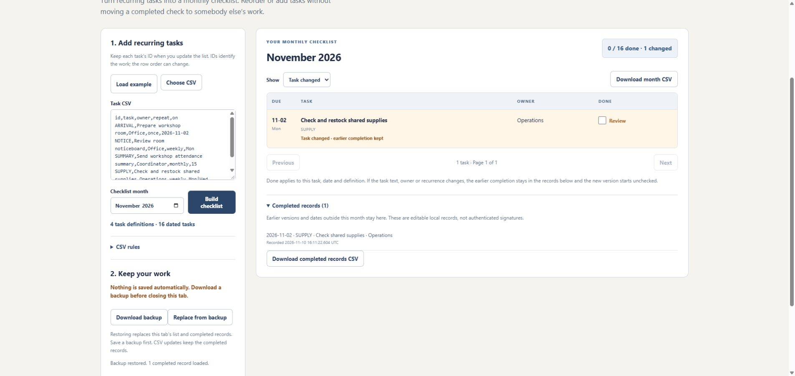

# Repeat Sheet

Build a monthly checklist from recurring tasks without attaching old checkmarks to new rows when the source list changes.

**[Open Repeat Sheet](https://srworkbench.github.io/repeat-sheet/)**. Free, no account or installation.



## Try it in two minutes

1. Click **Load example**. Three fictional recurring tasks produce 15 dated tasks for November 2026.
2. Mark **Check shared supplies** on **November 2** done.
3. Reorder the CSV rows or add a task with a new ID, then click **Build checklist**. The check stays with the same task and date.
4. Change that task's instructions to **Check and restock shared supplies**, then build again. It starts unchecked with **Task changed**. Open **Completed records** to see the original wording and date.

Nothing is saved automatically. **Download backup before closing or reloading the tab.** Choose **Replace from backup** to continue later.

## Import your tasks

Export your task list as UTF-8 CSV with these columns:

```csv
id,task,owner,repeat,on
SUPPLY,Check shared supplies,Operations,weekly,Mon|Wed
SUMMARY,Send workshop attendance summary,Coordinator,monthly,15
NOTICE,Review room noticeboard,Office,weekly,Mon
```

Choose the file or paste CSV, pick a month, and click **Build checklist**. File import builds automatically. The `owner` column is required, but its values may be blank. Extra columns are ignored. Blank records are skipped; error record numbers include the header and blank records. A quoted multiline field is one record.

Keep each task's ID when updating or reordering the list. IDs use letters, numbers, hyphens and underscores, up to 40 characters, and are normalized to uppercase. IDs must be unique. Never reuse an ID for different work.

| repeat | on | Meaning |
| --- | --- | --- |
| daily | blank | Every calendar day |
| weekdays | blank | Monday–Friday, including holidays |
| weekly | Mon\|Wed | The listed weekdays, separated by `\|` |
| monthly | 15 | That numbered day, if it exists |
| monthly | last | The last calendar day of the month |
| yearly | 02-29 | That month/day, if it exists in the selected year |
| once | 2026-11-02 | One exact date |

Dates use `YYYY-MM-DD`. Months range from 2000 to 2199. Missing dates, such as February 31, are skipped with a message; they never roll into another month. Dates do not move for weekends or holidays. Up to 100 task definitions are supported. The table shows 100 dated tasks per page.

## What a checkmark means

Each completion belongs to a task ID, due date and task definition. The definition includes task text, owner and recurrence. Changing row order or inserting other tasks does not change it.

If the definition changes, its earlier completed record keeps the original text and owner. The new version starts unchecked with **Task changed**. Mark it done after doing or reviewing the current work. Both versions can remain in the completed records. Reverting to an exactly matching earlier definition will show its earlier completion again.

Unchecking a version removes that version's completion record. These are editable local checklists, not authenticated signatures, approval workflows or immutable audit logs. Completion timestamps come from the device clock.

## Save and export

- **Download backup** saves the selected month, current draft CSV and all completed records as JSON. It includes a draft even if it has not built successfully yet. Backups are the way to resume work after closing the tab.
- **Replace from backup** replaces this tab's list and completed records after validating the file. Save your current work first. Restoring an invalid file leaves the current work in place.
- **Download month CSV** exports the entire built month, including status and matching completion times. The Show filter does not limit the download.
- **Download completed records CSV** exports all retained completions with the task text, owner and recurrence that applied when they were marked. The screen shows the latest 30 records; exports and backups include all, up to 20,000 records.

CSV exports prefix text that could be interpreted as a spreadsheet formula with an apostrophe. Such exported text differs from the original. Use the JSON backup to restore the checklist; CSV exports are readable reports, not restorable backups.

## Privacy and limits

Task CSVs and backups are processed in this browser tab. There are no upload requests, analytics, external scripts or browser storage. The web host receives ordinary page requests, not the task data. Closing or reloading clears the tab unless you restore a downloaded backup.

This is a single-person local tool. It does not sync, send reminders or merge two people's backups. A CSV update keeps completed records; restoring a backup replaces them. Copying a backup to another device copies its data, so handle downloads appropriately.

CSV text is limited to 100,000 characters, selected CSV files to 500 KB, backup files to 10 MB, task text to 160 characters and owner text to 80. Archive a full backup and start a fresh tab before exceeding 20,000 completed records.

The examples are invented. No workplace files or real completion records are included.

## Development

Plain HTML, CSS and JavaScript, with no build step or external libraries. Node is needed only for development checks:

```sh
node --test tests/core.test.cjs
node demo.cjs
```

The demo writes fictional exports under the ignored `output/` folder. When changing release assets, update the version on the stylesheet and script URLs together.

MIT licensed. An independent tool by SR Workbench.
